# Ritu Sharma

**Software Engineer** · Full-stack products, data pipelines and AI agents

    

---

### About

- Build **end-to-end products**: React / Next.js frontends, Python and Node.js APIs, and the data layer underneath.
- Work on **real-time analytics**, **OAuth integrations** and **ETL pipelines** with PostgreSQL, ClickHouse and Airflow.
- Build **LLM-powered agents** and workflows with LangGraph, LangChain and MCP.
- Care about clean architecture, secure auth and code that is easy for the next engineer to change.

### Tech Stack

**AI & Data Engineering**       

### Highlights

- **LeetCode Knight** · 700+ problems solved
- **CodeChef 3★**
- **Google Developer Student Clubs Lead** (2023)

---

Open to interesting problems and good teams · <a href="mailto:rsharma114962@gmail.com">rsharma114962@gmail.com</a>

